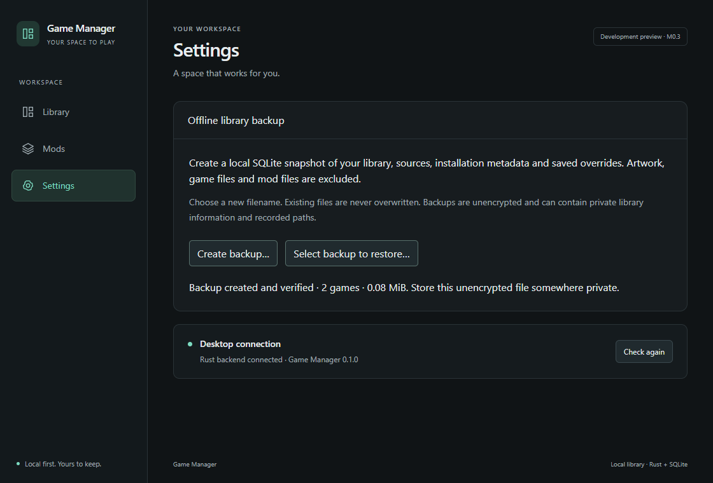
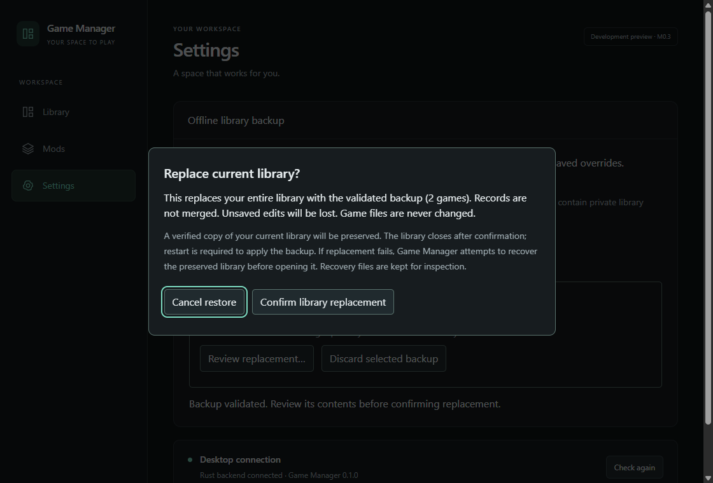
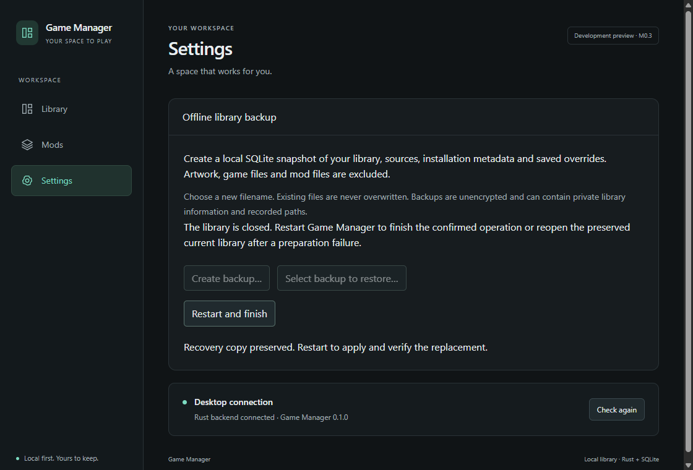
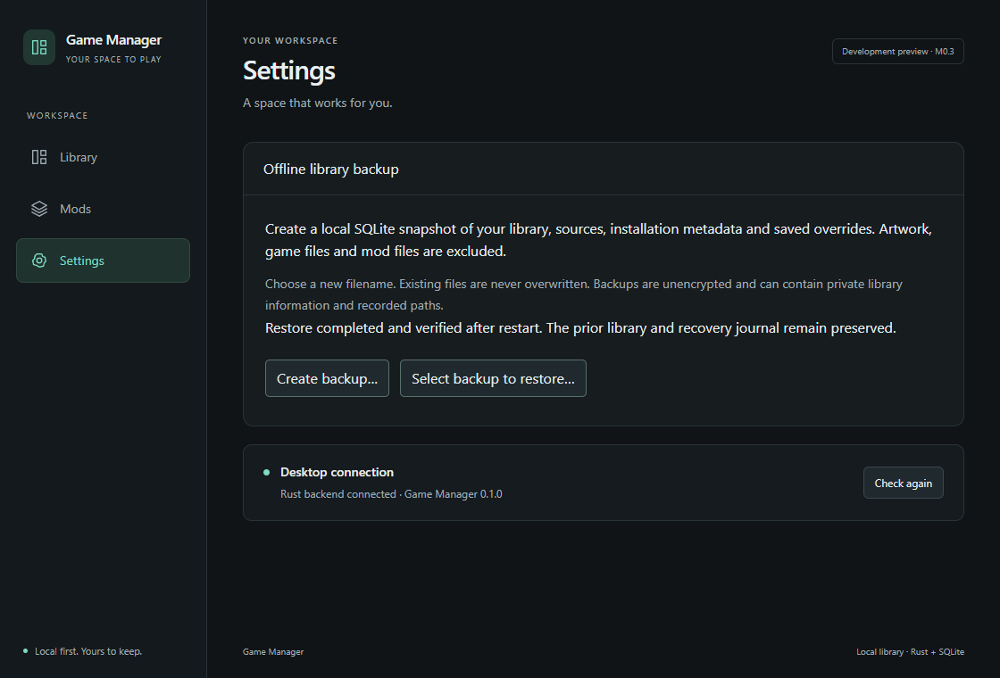

# M1.4 — Offline Library Backup and Restore

Status: **M1.4 complete within the documented local/current-schema scope**, verified on 2026-10-28 (America/Sao_Paulo). Backup and restore both passed final optimized native checks. No commit, push or merge performed.

## Baseline and authorization

The explicitly authorized task starts from `7566c657abe5c9b46125b9f8e48e32f06f54d5a8`, identical to HEAD, local main and fetched origin/main. The working tree was clean. PR #18 merged the M1.3C documentation closeout and removal of the incomplete native reader and its failing target. The historical report and ignored experiment evidence are preserved. ADR-008 remains accepted; Steam discovery remains deferred. The normal locked Rust suite passed all 54 tests, zero ignored. The initial Cargo invocation failed because the session PATH omitted Cargo; the README's session-only PATH adjustment resolved it. Branch: `feat/m1.4-library-backup-restore`, created from main. The roadmap has no conflicting M1.4 identifier or mandatory prerequisite. The explicit instruction brings this database-only reliability slice forward from broader M5 acceptance. No commit, push or merge is authorized.

## Restore design gate (before restore UI)

The existing OnceCell publishes a single SQLx Database. Unmounting React does not release it. A safe protocol must finish replacement before publishing database readiness, under a process-exclusive lock held for the lifetime of the application database. Benchmark databases and job fixtures cannot enter this protocol.

Implemented state machine, documented before restore UI and then reviewed against interruption tests:

1. **Idle:** ordinary services may read/write. No automatic backups or staging.
2. **Staged:** explicit native selection is copied into an application-owned disposable directory, then validated. The selected file is never migrated or written. A bounded summary and opaque confirmation token identify this exact candidate. Cancellation removes only owned staging. Current library remains untouched.
3. **Confirmed/quiescing:** explicit replace confirmation first promotes the candidate directory outside unconfirmed cleanup scope, then disables new database commands. Close the SQLx pool and await outstanding connections/transactions. Keep the process lock. Capture and fully validate a consistent snapshot of the now-quiescent original, including committed WAL data. Flush both snapshots. Partial or complete original copies created during preparation remain preserved even if the process exits before intent publication.
4. **Prepared:** preserve candidate and original in a unique recovery directory. Persist confirmed intent before any replacement. Restart is required; replacement never runs beneath live services. Failure here leaves the original and any recovery material preserved.
5. **Applying (next startup):** acquire the process lock before opening SQLx. Persist attempted intent. Preserve original main/WAL/SHM components in an owned displacement directory, individually. Install a verified copy of the candidate. These are separate operations, not an atomic multi-file rename.
6. **Verifying:** normal initialization/migration opens the candidate. Full schema, integrity, relationships and readiness checks precede durable completion and readiness publication.
7. **Data committed/finalizing:** publish a fully written, flushed completed marker only after verification. Preserve the pending reference as archived intent and update a non-authoritative last-status reference while preserving its predecessor. Retire only the redundant active pending reference before publishing readiness. Failure here retries metadata finalization; it must never roll committed data back. Keep the original snapshot, displaced files and journal. A subsequent restore must not overwrite them.
8. **Recovering:** before verified completion, an interrupted attempt or failed replacement/reopen conservatively restores a fresh verified copy of the preserved original before readiness. Persist recovering intent first; it takes precedence over an earlier completed marker until recovery verifies and publishes recovered completion. Preserve failed components too. Recovery is repeatable, including interruption during recovery. If recovery cannot establish a valid original, fail closed, preserve all evidence and surface recovery-required startup failure. Recovered completion uses the same reference-retirement protocol.
9. **Idle after completion:** ordinary startup opens current state without consulting historical status as recovery authority. If a retired pending reference reappears, a valid completion marker allows current-library validation and metadata retirement only; later edits/counts are preserved. Invalid completion combined with retirement evidence fails closed without replacing active data.

Invariants: never delete an uncertain database; never reuse a recovery name; no replacement while SQLx services are open; no migration of selected backup; no success before verification; no active mutation before confirmation; no benchmark-purpose restoration; original recovery snapshot is never used directly as the live database. Filesystem observations and journal state must be reconciled after interruption. File flushes and operating-system durability are distinct from proof against arbitrary storage corruption or actual power loss.

The design gate passed the real SQLite, process-interruption and native restart checks described below. ADR-009 records this implementation decision under the explicit task authorization; it is not a separately user-accepted guarantee against arbitrary power loss or media corruption.

## Backup format and mechanism

The format is a standalone, unencrypted SQLite database, without compression or an archive container. SQLite documents [VACUUM INTO](https://www.sqlite.org/lang_vacuum.html#vacuum_with_an_into_clause) as a consistent-snapshot alternative to the online backup API that leaves the source database unchanged. It includes committed WAL state rather than copying the live main file. Application identities are explicit primary keys; internal rowid reassignment is not a canonical identity change.

The source uses one connection from the unchanged four-connection pool. SQLite runs on its SQLx worker. The connection returns before snapshot validation and filesystem publication. Output is first written into a disposable destination-side directory, then fully validated and flushed. A same-directory hard link publishes the complete file without an overwrite race; an existing name fails even if another process creates it after the dialog. The published file is flushed too. Failure after publication preserves the complete output instead of deleting user data. Failure before publication removes owned temporary output. Cancellation is cooperative before/after SQLite work and immediately before publication; an in-flight VACUUM is allowed to finish safely. Cancellation can lose the race to publication, which the UI explains.

No data is loaded as a full library in React. Snapshot responses contain only format/build/schema information, byte size and four counts. The build version in that response identifies the validating build, not a serialized creator manifest. The SQLite migration history is the file's compatibility identity; creation time is ordinary filesystem metadata. No claim of an embedded signed manifest, encryption or authenticity is made.

## Validation and compatibility

Selected files are opened read-only with native sharing that excludes ordinary writers/deletion, checked for the SQLite header and a 1-GiB size limit, then copied into private staging. Live sidecars (`-wal`, `-shm`, `-journal`) cause refusal. The selected file is never opened by the migrator or SQLite validator. Windows [drive-type checks](https://learn.microsoft.com/en-us/windows/win32/api/fileapi/nf-fileapi-getdrivetypew) allow fixed/removable local drives and refuse mapped network drives; existing path checks refuse UNC/device/traversal inputs and maintenance refuses alternate data streams.

Validation uses read-only immutable SQLite access to the owned copy, with trusted schema disabled and a 2-MiB page cache. It requires application purpose, the exact two successful embedded migration versions/checksums, exact application table/index SQL, integrity_check, foreign-key consistency, application metadata without synthetic generation flags, and agreement between explicit overrides and the effective projection. NULL and explicit favorite `0` are compared using SQLite IS semantics. Schema/history results and integrity/FK failure collection are bounded. Extra tables/triggers, missing structures, changed histories, newer schemas, old v1 snapshots, benchmark purpose, corrupt/truncated files and invalid relationships/overrides are refused.

Only current schema v2 is supported in this first format implementation. Selected older files are not upgraded merely to test compatibility. Normal startup/migration remains the reopening path after replacement; future backward compatibility requires explicit migration/recovery tests rather than weakening the schema gate.

## WAL, service and process lifecycle

Application initialization acquires an exclusive OS-backed File lock at `<database>.gm-lock` before opening SQLx or processing confirmed intent. A second cooperating application process fails before database access. Normal close drains the pool and releases the lock; confirmation drains the pool while retaining the lock until controlled restart or process exit. Restart explicitly verifies stopping, a closed pool and zero connections, then releases the lock before Tauri spawns the new instance. Installed Tauri 2.12.5 source shows spawn precedes process exit; this explicit handoff avoids relying on startup timing. Existing SQLx WAL/FULL, pool/acquisition/busy limits, indexes and production queries remain unchanged.

Every database IPC service goes through DatabaseState readiness. Confirmation sets stopping before closing the pool: new requests fail NOT_READY, admitted requests either finish under pool draining or fail closed when acquiring a closed pool. A pre-existing transaction's committed edits are included in the preserved original. The stopped OnceCell is not rebound beneath running services. The only permitted restart command requires the stopped state.

The confirmed directory contains candidate.sqlite3, previous.sqlite3, prepared/attempted/completed/recovering/recovered markers as applicable, the intent record and individually preserved displaced components. Markers require the complete 24-byte protocol payload, published through a flushed temporary file without overwriting. Partial control remnants are preserved separately before a fresh marker is published. Presence alone never proves completion. The pending pointer has a bounded relative basename, is created without overwriting, and is flushed before replacement. Completed intent is archived and retired before readiness; the last-status reference is never recovery authority. Confirmed directories are never cleanup targets. Marked unconfirmed staging is separately scoped and cleaned under the process lock after interruption. Persistent lock/owner/journal files are intentional durable state, not leaked handles or temporary outputs.

Filesystem copying/comparison and replacement run on blocking workers, outside frame-critical query paths. Copy verification uses two 64-KiB buffers; neither snapshot is opened directly as the writable recovered application database. The protocol does not treat the main, WAL and SHM moves as one atomic operation. Attempted but uncommitted intent selects conservative original recovery. A committed marker permits metadata finalization only. Failure to validate the prior snapshot or finish recovery fails startup without deleting evidence.

See [ADR-009](../decisions/ADR-009-offline-library-restore-lifecycle.md) for the implementation decision and retention boundary.

## Identity preservation and failure tests

The real SQLite fixture compares every application table and every SQLx migration field before backup and after restore/restart. It includes duplicate Unicode titles with distinct canonical IDs, multiple sources per game, multiple installations per membership, owned/uninstalled games, explicit NULL overrides, explicit false favorite, all four completion states, user presence and legacy presence, stable source/entry/installation IDs, timestamps, revisions 17/99/7, and manual/legacy provenance. Repeated restore preserves earlier recovery sets and archives earlier intent rather than overwriting them.

The maintenance suite includes:

- Empty/populated backups; committed WAL edits; concurrent bounded reads with an uncommitted writer; selected-file preservation; cancellation; destination collision; failed publication and truncated owned output with injected StorageFull; no remaining owned backup/install temporaries.
- Actual Windows sharing denial on the selected backup and actual disposable-directory ACL write denial, with fixture ACL restoration.
- Wrong purpose, changed/newer/dirty migration histories, missing/extra tables, broken foreign keys, mismatched overrides, synthetic metadata, arbitrary/truncated files and live sidecar refusal.
- Cancellation of staged candidates; single-root ownership exclusion; pool close waiting for an existing transaction; zero remaining pool connections; exact prior-snapshot verification.
- Injected failures around intent, individual component displacement, installation, reopening and verification, recovering the original after each. A native exclusive handle also causes a real candidate-open failure.
- Panics at three lifecycle boundaries, followed by recovery; ten child-process exits with code 86, bypassing Rust destructors at attempted intent, each component-displacement boundary, installed/reopened/verified states, and displaced/installed recovery states. Some sidecars are already absent after clean close; an individual boundary does not imply that a nonempty sidecar was moved in every fixture. A separate child exit during unconfirmed staging verifies cleanup and unchanged active contents. Another exits after validating the original copy during confirmed preparation, proving that restart does not delete it. A lock-handoff test keeps the old stopped Database alive while the new instance restores and proves old services cannot resume or unlock the new owner.
- Three further actual child exits at last-status publication, intent archival and pending retirement, plus injected errors at those boundaries, preserve the committed candidate. Total: **15 child-process exits**, in addition to the three panic cases. Empty completion/recovered markers cannot suppress recovery. Damaged historical metadata after success cannot replay a prior snapshot over revision 888. Reappearing completed intent preserves later added records; damaged completion with retirement evidence fails closed while direct read-only inspection confirms unchanged active records.

These are actual process exits and sharing/ACL fixtures on disposable NTFS roots. They are not physical power cuts, filesystem corruption campaigns, disk removal or a supported-Windows/filesystem matrix. Disk-full cleanup uses an injected StorageFull after partial output; no physical volume was filled. Recovery snapshots deliberately remain after confirmed operations; no automatic recovery-data retention policy is introduced.

## UI and native verification

Settings contains the compact backup panel. Native Windows save/open dialogs supply paths inside Rust; IPC accepts no filesystem paths, SQL or shell commands. Destination overwrite is disabled. Selection validates a private copy before exposing Review replacement. The modal explains full replacement, lack of merging, unsaved edits, preserved originals, restart and recovery behavior. Cancel is the initial focus; Tab/Shift-Tab are contained and focus returns on close. Confirmation prepares recovery data and closes the library; a separate Restart and finish action applies and verifies it. The success message is read from the completed startup journal, not inferred from a completed file copy.

Seven main-window capabilities grant only typed maintenance commands. Benchmark and job views report maintenance unavailable and reject operations before dialogs or file access. Native bindings are confined to standard Windows common file pickers and drive classification; no Steam reader is present.

The final ordinary optimized binary passed `benchmarks/backup.ps1` in new disposable root `benchmarks/results/m1.4-native-backup-04`. Six real Windows save/open dialogs exercised new publication, selection cancellation, wrong-purpose refusal, destination collision, validated review/cancellation and confirmed restoration. The driver checked confirmation text/viewport, initial Cancel focus and ten Tab presses, stale token/concurrent backup rejection, blocked writes after confirmation, actual Tauri restart, exact saved details and replacement of three current games with two backed-up games. A second independent process launch rechecked exact IDs/overrides and completed status. After each phase the active pending reference was absent and preserved historical status present. The runner closed all test windows normally.

Reviewable WebView screenshots contain generated test data only; native OS dialogs with personal sidebar entries are not included:

| Backup verified                              | Replacement confirmation                                             |
| -------------------------------------------- | -------------------------------------------------------------------- |
|  |  |

| Prepared, restart required                      | Verified after second launch                                                            |
| ----------------------------------------------- | --------------------------------------------------------------------------------------- |
|  |  |

## Quality checks and development attempts

Frozen pnpm install accepted the unchanged lockfile. TypeScript, ESLint, package Prettier/rustfmt and **53 frontend tests** passed. The final backend cohorts passed **72 default and 95 benchmark-feature tests**, zero ignored, plus warnings-denied all-targets Clippy in both configurations. All 18 maintenance tests run in the ordinary library suite; no experimental windows_reader target exists. No package version or checksum is changed; tempfile and windows-sys already existed in Cargo.lock and gain narrow runtime uses.

Preserved failed development attempts: the first typecheck rejected Array.at under the existing target, corrected without changing the target; first Clippy rejected an unnecessary and_then and unit binding, corrected without suppressions. Initial Windows binding constant placement was corrected before passing native builds. A test-output redirection used one too many parent directories and did not run the command; the corrected absolute output path succeeded. Native Cargo progress on stderr produces PowerShell NativeCommandError formatting in some redirected logs; pass/fail uses the actual process exit code. Early inspection-only PowerShell brace expansion and a root-level package.json lookup failed without changing files. Review corrected a size-contract mismatch, promoted confirmed preparation outside cleanup before capturing originals, and added the explicit Tauri restart lock handoff. Earlier passing cohorts/builds were superseded by final-source runs.

Two intentionally added regressions failed before fixes and their output is retained: `m1.4-partial-markers-before-fix.txt` showed empty success markers suppressing recovery when the active file was missing; `m1.4-history-retirement-before-fix.txt` showed damaged historical completion replaying an old snapshot over later revision 888. Full-payload marker publication, recovering intent and retirement of active recovery authority fix these defects. Both regressions and complete suites subsequently passed. Original assertions were preserved; the Settings placeholder expectation now checks the implemented backup panel.

Native pilot 01 timed out while the operator resolved the owned common dialog; its output was retained and the app closed. Pilot 02 selected a frozen benchmark source with live SQLite sidecars; production correctly refused a live database before the driver's expected purpose error, so that driver assertion failed. The final runner creates a standalone wrong-purpose fixture using SQLite online backup, preserving the original frozen file. Pilot 03 passed before the final journal improvements; pilot 04 is the final-source evidence. Chromium emitted a non-fatal `Failed to unregister class Chrome_WidgetWin_0`, error 1412, during final flow shutdown; both workflow phases, normal close and subsequent launches passed. No security assertion was weakened to obtain a pass.

## Performance and resources

An isolated optimized real-SQLite probe ran after both native builds/tests finished, on this Windows workstation and local NTFS disposable roots with OS caches retained. Fixture insertion is outside timing. Each application-purpose database has one membership per game and half as many installation assertions; it does not alter the historical benchmark files. One measurement per size is characterization, not a distribution or release threshold.

| Games  | Snapshot bytes | Backup ms | Select/copy/validate ms | Confirm/drain/preserve ms | Restore startup ms |
| ------ | -------------: | --------: | ----------------------: | ------------------------: | -----------------: |
| 15,000 |      5,001,216 |    188.07 |                  142.53 |                    286.85 |             382.50 |
| 25,000 |      8,290,304 |    868.30 |                  259.18 |                    417.61 |             580.23 |

Restore startup measures replacement, normal SQLite initialization, validation and intent retirement; it excludes whole-process Tauri/WebView construction. Original preservation and candidate validation are measured separately. The 25k backup has visible run-to-run variation compared with earlier development probes; these single samples establish no performance improvement or upper bound. These maintenance operations do not use frame-critical browsing budgets.

Relevant retained buffers: two 64-KiB copy-comparison buffers (131,072 bytes), bounded control/schema/history data and private SQLite validation cache 2 MiB per validator connection. The unchanged live pool limit is four; tests require it closed with size zero before replacement. Selected handles and temporary destinations are dropped, and disposable roots can be removed after close. This is not a measured total-process peak-RAM or universal handle-leak bound. No full library is retained in frontend state. SQLx performs VACUUM on its SQLite worker; copy/validation/replacement use background/blocking work. Real SQLite concurrent reads/writes pass, native UI status/focus remains operable during the small workflow, and the established 15k/25k browsing drivers are separate checks. A 15k/25k frame trace during maintenance, lower-memory hardware and OS-cold/HDD maintenance measurements remain unmeasured.

## Production and benchmark isolation

Ordinary startup opens the existing library, acquires its ownership lock and cleans only marked unconfirmed staging. It creates no automatic backup and performs no replacement without outstanding confirmed pending intent. Historical last-status data has no replacement authority. Fresh ordinary databases remain empty; invalid benchmark/synthetic configuration is ignored and benchmark-only commands rejected. Benchmark-purpose files cannot be restored. Native command handlers/capabilities accept no paths, shell, SQL or unrestricted filesystem operations.

All six frozen main database files are checked against the before hashes after final native regressions. SQL migrations, production query implementation, pool constants, both dependency lockfiles, ADR-001 through ADR-008 and M1.3C historical report remain unchanged. No Steam experimental reader, game-directory traversal, tokens/accounts, cloud, schedules, launching, mods or subsequent milestones are introduced. Native tests use new disposable application/profile roots only.

Final SHA-256 values match all six before values in `m1.4-reference-{before,after}.json` (same `synthetic-v1-seed-42-<size>.sqlite3` filenames):

| Games  | SHA-256                                                            |
| ------ | ------------------------------------------------------------------ |
| 500    | `DFC9D2115125D629232EE648F13E2CC0A599EBB1B0A994552136AEE75CFD8124` |
| 2,000  | `56ABA98719C2DBF5C6AACFF8A0D5D230EEB5CE4E625299B332AB9195A7F00FAD` |
| 5,000  | `C76F7914F16BF738E5661784FA00458E7F4F3C4CC35A38E99F76069D8992B7C1` |
| 12,320 | `4BAC17A5F859E2E97EA9CADEC97DC9D88EFBED74509CE0A1736AFF18B294BB66` |
| 15,000 | `3CCE0FAB1D5F486D572FD15CC137D8A5BEDA17529B9680BF4C5F55EE4668A95D` |
| 25,000 | `849DF6B55BE22064484AD56CF6E065B73DB28D952779B9C7ECD204B6339B4538` |

## Final checks and evidence

Local generated logs, executables, SQLite files and raw benchmark output remain ignored under `benchmarks/results/`; only the four synthetic UI screenshots above are included as documentation artifacts. Commands use the repository's session-only Cargo/pnpm PATH adjustment.

| Check                                                                          | Result / retained evidence                                                                                                                        |
| ------------------------------------------------------------------------------ | ------------------------------------------------------------------------------------------------------------------------------------------------- |
| `pnpm install --frozen-lockfile`                                               | Passed; lockfiles unchanged                                                                                                                       |
| `pnpm typecheck`, `pnpm lint`, `pnpm format:check`                             | Passed; `m1.4-final-typecheck.txt`, `m1.4-final-eslint.txt`, `m1.4-final-format.txt`                                                              |
| `pnpm test`                                                                    | 12 files, 53 tests passed; `m1.4-complete-frontend.txt`                                                                                           |
| `cargo test --locked`                                                          | 72 passed, none ignored; `m1.4-retired-authority-default.txt`                                                                                     |
| `cargo test --locked --features benchmarks`                                    | 95 passed, none ignored; `m1.4-retired-authority-benchmarks.txt`                                                                                  |
| `cargo clippy --locked --all-targets -- -D warnings` and feature equivalent    | Both passed; `m1.4-retired-authority-clippy-{default,benchmarks}.txt`                                                                             |
| Production frontend build                                                      | Passed as part of both final native builds                                                                                                        |
| `pnpm desktop:build`                                                           | Ordinary optimized Windows build passed; `m1.4-complete-build-ordinary.txt`                                                                       |
| `pnpm tauri build --no-bundle --features benchmarks -- --locked`               | Optimized feature build passed; `m1.4-complete-build-benchmarks.txt`, retained `m1.4-benchmark-complete.exe`                                      |
| Optimized maintenance probe                                                    | Passed, 15k/25k; `m1.4-complete-release-scale.txt`                                                                                                |
| `backup.ps1` native workflow                                                   | Both flow/verify passed; `m1.4-native-backup-04`                                                                                                  |
| Existing `manual.ps1`                                                          | Create/edit/remove/empty phases passed across four launches; `m1.4-manual-final`                                                                  |
| Existing `startup-errors.ps1`                                                  | Empty/missing/directory/corrupt/locked/blocked-data-root passed; `m1.4-startup-errors-final`                                                      |
| Existing `frontend.ps1 -NormalSmoke -Sizes 15000 -Runs 1`                      | Passed, empty schema-v2 app DB, benchmark command rejection and invalid synthetic config ignored; `m1.4-production-isolation-final`               |
| Existing browsing driver, `-Sizes 15000,25000 -Runs 1`                         | Both passed, 26 maximum mounted rows and six retained pages; `m1.4-browsing-final`                                                                |
| Existing `-QueryScenarios`, same sizes/runs                                    | 18 scenarios per size passed, 26 maximum rows; `m1.4-query-final`                                                                                 |
| Final format, script syntax, document links, fixture/protected-file/diff audit | Passed: package format/rustfmt, Node/Python/PowerShell syntax, 147 local document/image links, six hashes, protected files and `git diff --check` |

All final native regression runners completed sequentially with exit zero and no competing builds/tests. Browsing first-usable service samples were 165.1 ms at 15k and 143.0 ms at 25k; these are the existing driver's finite in-process samples, not whole-process startup or physical presentation. No M0 exception or performance target is reopened. After normal shutdown no Game Manager test process or port 9223 listener remained.

Final optimized binary SHA-256 (`m1.4-binary-complete-hashes.json`): ordinary `82D2B04E3052119DED68BA57434357A3F91EECCEC93AA927E82C20048F867C68`; benchmark `050DB04223E0497938A92FCB36ED686853C2F772537B65862297AC40E8DBCDE2`. Both were built after the final journal fixes. The feature executable is retained separately before building ordinary production. No installer/bundle signing or distribution was undertaken.

Completion disposition: **both required capabilities pass**. Backup publishes a validated consistent committed snapshot without changing library contents. Explicitly confirmed restoration closes services, preserves the current library, applies before readiness, verifies exact data through restart, and exercises a recoverable original across the documented failure boundaries. No restore safety blocker remains in this verified scope. The limitations below remain explicit. HEAD, local main and origin/main remain at the verified baseline; all task changes are uncommitted on `feat/m1.4-library-backup-restore`.

## Changed files

- Rust snapshot/validation/lifecycle and real-SQLite tests: `apps/desktop/src-tauri/src/storage/maintenance.rs`, `storage/maintenance/tests.rs`.
- Native pickers, session/admission/restart commands: `src-tauri/src/maintenance_commands.rs`; integration in `src/lib.rs`, `src/storage/mod.rs`, `build.rs`, `capabilities/default.json` and seven generated `backup_*.toml` permission definitions.
- Runtime uses of existing locked dependencies: `src-tauri/Cargo.toml`; benchmark job constructors in `src/jobs/mod.rs` and `src/jobs/fixtures.rs` explicitly have no application maintenance lifecycle.
- Settings workflow and runtime-validated IPC: `src/features/backup/BackupPanel.tsx`, its test, `src/ipc/backup.ts`, its test, `src/App.tsx`, `src/App.css`, `src/App.test.tsx`.
- Reproducible native smoke: `benchmarks/backup.ps1`, `frontend-backup.mjs`, `prepare-backup-validation-fixture.py`, benchmark README.
- Root/desktop READMEs, PROJECT_STATUS, ROADMAP, decisions index, new ADR-009, this report and four `docs/development/evidence/m1.4/*.png` screenshots. No generated databases, executables, credentials or personal game files are included.

## Limitations and next task

Initial support is current application schema v2, standalone snapshots up to 1 GiB and local fixed/removable paths with hard-link support. NTFS is verified; FAT/ReFS/removable-media behavior and broader supported-Windows versions are not certified. Selected backups with live sidecars are refused. Backups are unencrypted database metadata only, excluding game/mod files and artwork. Same-user malicious manipulation, arbitrary media corruption, disk removal and physical power cuts are outside the tested guarantee. Partial-output/disk-space behavior uses injected StorageFull; no real volume was filled. Recovery copies consume space and remain preserved without a retention UI or silent deletion. If recovery data is missing/invalid or metadata is ambiguous, startup fails closed for explicit inspection; no automated repair of arbitrary external corruption is claimed.

Recommended next separately authorized task: choose the remaining M1 slice for configurable installation grouping and the LaunchProfile identity contract, before implementing launching. Keep Steam discovery deferred under ADR-008 and preserve M1.3C research. M0 exceptions E1–E5 remain accepted and unchanged. No later milestone begins automatically.
