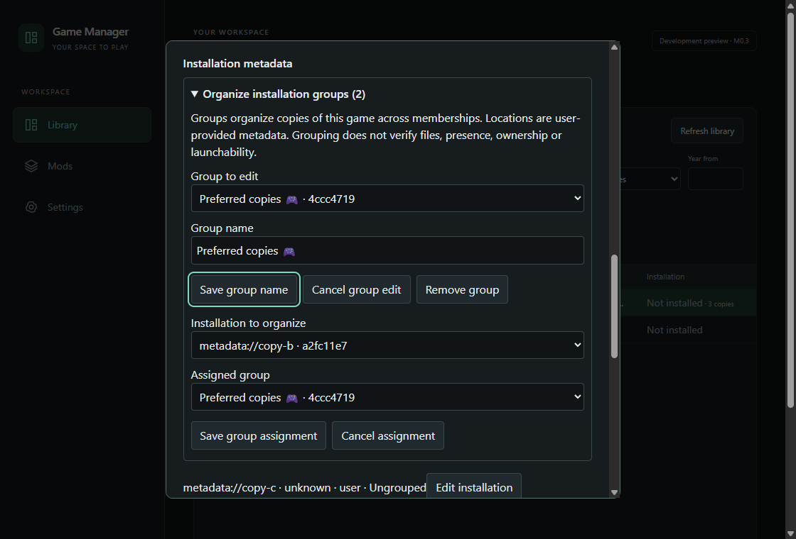
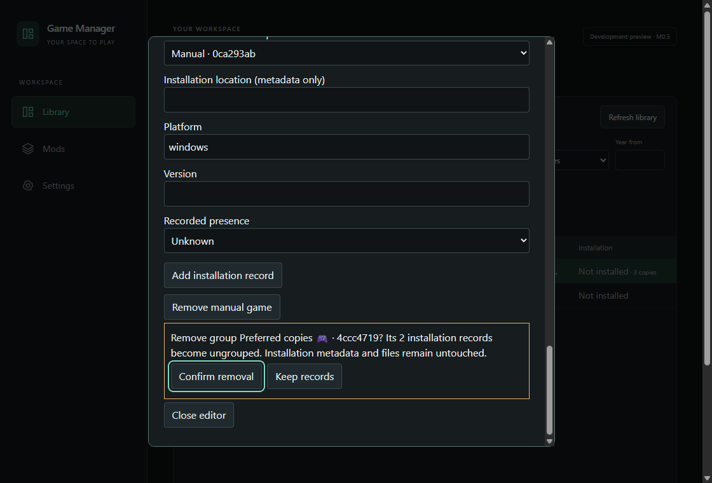

# M1.5 — Installation Grouping Verification

Verification date: 2026-10-29. **M1.5 is locally complete and verified within its authorized scope.** This report does not claim launching, production LaunchProfile persistence, Steam discovery/importing or mod management. No commit, push, merge or subsequent milestone is authorized or performed.

## 1. Requirements, baseline and grouping semantics

Started from a clean working tree on `feat/m1.5-installation-grouping-launchingprofile-identity-contract` at `8ce5b51b41baa41931b1b331514f45c7d2f60ab2`, identical to local main and origin/main. GitHub PR #19 was merged; its head `7c968a7f069e85668771d353c8df202cb93a89f8` passed CI run `40809184553`. GitHub contained no submitted reviews/comments; the user's separate "You're authorized" instruction satisfied the review/authorization gate for this task. M1.5 was the proposed identifier; the existing roadmap had no conflicting numbered slice.

Reviewed AGENTS, root/desktop README, PROJECT_STATUS, ROADMAP, source register, relevant PRD/TAS/DSS/MDRS sections, ADR-001 through ADR-009 and M1.1/M1.4 reports. The existing Rust manual service, migrations, projections, query/source filters, overrides, bounded editor/request gate, capabilities, maintenance validator and journal/recovery tests determine implementation behavior. Historical planning-only status is superseded by the current project evidence and explicit authorization.

PRD requires configurable multiple-installation grouping. TAS section 4 and DSS sections 3/4.3 already separate canonical games, memberships, installations and installation-bound LaunchProfiles. [ADR-010](../decisions/ADR-010-installation-grouping-and-launch-profile-identity.md) selects a flat per-canonical-game group, spanning that game's memberships. An installation has at most one group, or is ungrouped. A global taxonomy, nested hierarchy, tags and cross-game grouping are unnecessary for this slice.

## 2. Identity and provenance invariants

- Canonical game → memberships → installations remains one-to-many at each step. Each keeps its stable independent ID; equal titles, names, basenames and paths never establish identity.
- Group IDs use the existing independent random 128-bit text-ID convention. Display names may duplicate, support Unicode and may be renamed without replacing an ID. Names are trimmed, nonblank, at most 80 Unicode scalar values and contain no control characters. The UI displays ID prefixes to distinguish equal labels.
- Location edits preserve installation and canonical identity and grouping. Groups carry no paths, presence, ownership, executable, account or launch state.
- User organization may include provider/legacy installations without changing source/external identity, state provenance or their existing read-only metadata/deletion policy. Group actions do not touch overrides, including explicit SQL NULL.
- Group actions increment the game's revision and timestamp atomically; they do not change title/source/presence projections. No title-based association, provider importer or game-file operation is introduced.

## 3. Schema and bounded reads

Forward application migration `0003_installation_groups.sql` adds only `installation_groups(id,game_id,display_name)` and `installation_group_members(installation_id,group_id)`. Indexes bound game-group lookup and group-member cleanup. Assignment primary keys enforce zero/one group per installation. Foreign keys cascade an assignment when its group or installation is removed; canonical removal cascades groups. Insert/update triggers reject cross-game assignments, and a group cannot be reparented to another canonical game. Membership/installation reparenting is not exposed by the existing editor and remains outside this contract.

The historical v1/v2 migrations are unchanged. Existing games, sources, memberships, installation columns, overrides and query indexes are unchanged. Application startup runs the normal transactional SQLx migration; no mandatory library scan or altered pool/WAL/scheduling policy is added. Generator-v1 fixtures still use their exact v1 migration prefix, including read-only benchmark viewing.

The existing narrow `manual_mutate` command gains typed save-group, assign-group and remove-group actions. No new unrestricted command/capability or dependency is needed. `manual_get` loads at most 100 memberships, 100 installations and 100 groups for one selected game. Existing membership/installation limits stay intact. Only the bounded editor adds an indexed assignment join; browsing/count/filter/search/source projections and frontend page/cache limits do not load groups.

## 4. UI workflow and accessibility

Manage selected game contains a collapsed **Organize installation groups** section. Choose New group or an existing name/ID, edit its name, then explicitly Create group/Save group name; Cancel group edit discards that draft. Choose one installation by its metadata location/ID and a group (or Ungrouped), then explicitly Save group assignment; Cancel assignment discards the selection. Provider records can be organized without becoming editable installations. Each installation row shows its saved group or Ungrouped.

Remove group names the saved group and ID prefix, counts its current assignments and requires confirmation that installations become ungrouped while metadata/files remain. Canonical and membership confirmations describe the effect on groups/assignments. Restore confirmation also explains group replacement, and selecting v2 explains that the restored library starts with no groups while the selected file remains unchanged.

The existing viewport/modal geometry, virtualized Details View and explicit forms remain. Group controls use native labels/selects/buttons and inherited focus styles; collapsed controls do not open an unbounded browser. Removal confirmation focuses Keep records and contains Tab traversal; closing restores prior focus. Successful writes refresh only bounded details, preserving unrelated drafts and existing library invalidation. Failed writes keep drafts. Per-game revision checks surface conflicts without silent retry. Initial details requests and pending mutation follow-ups are discarded after editor unmount; synchronous admission prevents duplicate in-flight submissions.

The ordinary optimized binary passed `grouping.ps1` in `benchmarks/results/m1.5/grouping-02`: create/rename, duplicate Japanese/emoji names with explicit code-point assertions, cross-membership assignments, ungrouping, draft cancellation, stale-revision rejection, modal traversal/geometry, exact restart identities and confirmed group removal. The four-launch original manual workflow passed in `manual-01`. Screenshots were inspected at native size; only generated WebView test data is included, without native-picker sidebars.

| Saved group and assignment                            | Explicit group removal                                        |
| ----------------------------------------------------- | ------------------------------------------------------------- |
|  |  |

## 5. Migration and populated-data preservation

Real SQLite tests build exact schema v2 using the unchanged embedded prefix, with manual/legacy/provider data, independent duplicate titles, multiple memberships and installation records, explicit NULL overrides and nonzero revisions/timestamps. A deliberately conflicting new-table fixture causes migration failure: its partial DDL rolls back, version remains v2, and existing records remain. Removing only the fixture blocker permits the normal upgrade; legacy origin/provider source, IDs, presence, override and revision values are retained. New groups start empty; existing installations start ungrouped.

Grouping tests cover Unicode/equal names with independent IDs, create/rename/assign/unassign/remove, multiple copies per membership and memberships per game, location-string changes, unchanged query/count/source semantics, provider protection, restart identity, cross-game ID/SQL rejection, bounds and concurrent/stale revisions. Installation deletion removes only its assignment; membership deletion removes assignments for its deleted installations and retains groups, even empty groups. Permitted canonical deletion removes its groups/assignments and preserves the unrelated same-title game.

## 6. Backup and restore compatibility

Migration adoption was conditional on preserving the previously supported v2 backup format. The validator now accepts exactly v2 or v3 successful migration prefixes/checksums and their corresponding exact schema SQL. It retains integrity/FK/application-purpose/override checks, bounded result collection and the 1-GiB/local hard-link storage limits. V3 adds a cross-game assignment consistency check. V1, benchmark purpose, modified/newer histories, extra structures, corrupt data and inconsistent relationships/overrides remain refused.

All newly created application snapshots are v3. Exact v2 backups are validated without migration. Selected bytes and preserved candidate/original snapshots remain unchanged. Only a copied active database upgrades through normal transactional initialization before readiness/completion. A v2 round trip checks stable records, NULLs and revisions, produces a restorable v3 snapshot and survives two restarts. Injected failure after reopening a v2 active copy recovers the grouped v3 original. A synthetic historical M1.4 attempted journal with a preserved v2 original recovers and upgrades only its active copy while preserving the v2 original bytes.

The existing M1.4 exact dump comparison now includes both group tables and assignments while retaining every original field/history assertion. Fixtures include empty duplicate groups, grouped manual/provider copies and ungrouped legacy presence. Cancellation, publication/sharing/ACL failures, committed WAL/uncommitted writers, original preservation, 15 child-process interruptions, incomplete markers, recovery retries, lock handoff and non-replay of completed history remain regression requirements. The journal/replacement/retention protocol is unchanged; only schema compatibility validation is extended in ADR-009/010.

The final ordinary optimized binary also passed `backup.ps1` in `backup-01`, including six actual Windows file-picker interactions, collision/wrong-purpose refusal, review/cancellation, stale token and concurrent-operation refusal, stopped-service writes, controlled Tauri restart and an independent second launch. After backup, the test renames a group and removes its assignment; restoration recovers the exact earlier name, assignment, IDs, overrides and revisions, replaces three current games with the two backed-up games, and retires active pending intent while preserving originals/history. All original M1.4 native assertions remain.

Old M1.4 binaries cannot read new v3 backups. No downgrade format, merge restore or retention cleanup is added. Keep original v2 backups for older builds. No previously supported v2 backup is silently rejected because grouping was added.

## 7. LaunchProfile identity and lifecycle contract

[ADR-010's future LaunchProfile contract](../decisions/ADR-010-installation-grouping-and-launch-profile-identity.md#future-launchprofile-contract-separately-reviewable-not-persistent-functionality) is separately reviewable. Profiles require independent stable IDs, canonical game association and one installation binding. Membership is derived through installation, avoiding a contradictory second binding. Several profiles can belong to the same installation/game and may share display names or target strings. User provenance is distinct from future namespaced provider provenance; a provider association must match the installation's source.

Name or installation metadata edits preserve profile identity and explicit target references; a future prepared launch decision must revalidate profile and installation/game revisions. Profile updates/deletes require exact revisions. Future executable reference, literal argument array, working-directory reference and launcher-kind fields are described without discovering, validating or executing any target.

Future installation/membership/canonical deletion must refuse while profiles reference affected installations or explicitly review/delete their enumerated metadata in one transaction, clearing defaults and retaining existing provenance gates. A default is an optional explicitly chosen per-game profile ID; no automatic alphabetical/path/provider fallback. Group removal has no profile/default effect. The deterministic SQLite test-only association model validates required bindings, provider-source checks, independent equal labels/targets, stale updates/default selection, restrictive deletion, reviewed cleanup and cleared defaults without retargeting. The test-only tables never enter application migrations, IPC or UI.

## 8. Failure, conflict and deletion behavior

All group mutations run under the existing `BEGIN IMMEDIATE` transaction and exact expected game revision. Concurrent edits have one winner and one surfaced conflict; the loser does not partially mutate records. Invalid/foreign/missing IDs, invalid names and the 101st group are rejected with rollback and no revision advance. No hidden retry overwrites a draft. UI confirmation cancellation performs no mutation. Same-name groups remain independently addressable.

Group removal deletes its assignments only. Empty groups persist after membership/installation removal until explicit group or permitted canonical removal. Existing last-membership, provider/legacy and metadata-only deletion restrictions remain. Backup validation failures preserve selected and active files. Recovery behavior follows ADR-009; no SQLite transaction is represented as an atomic multi-file filesystem replacement.

## 9. Resources and performance

No production browsing SQL, DTO projection, index, scheduling policy, cache/page/worker limit or row geometry changes. Group data is fetched only for a selected game's bounded editor. Group tables add storage proportional to groups and assigned installations, with indexed game/group lookup and one assignment per copy. There is no launch-profile persistent storage or frontend library-sized group cache.

Measurements use Ryzen 5 4500, approximately 64 GiB RAM, Windows 11 Pro build 26200 and disposable local NTFS application roots on E:. Node 26.12.1, pnpm 12.15.0 and Rust/Cargo 1.99.1 are recorded in `benchmarks/results/m1.5/environment.json`. These are warm-cache desktop samples with ordinary background activity, not controlled cold/storage or lower-memory certification. Collection followed builds/tests; no competing build/test ran during measured regressions.

`manual-query.ps1` compares the retained verified M1.4 schema-v2 binary with schema v3 in two alternating passes at each size. `-BaselineSchema 2 -CandidateSchema 3` preserves exact version assertions; original defaults 1/2 retain the historical M1.1 procedure. Summary artifact-slot labels v1/v2 identify baseline/candidate, not schema versions. All **24 size/case rows** match counts, complete row IDs and every projection value. There are 40 timed page/IPC samples per artifact/case (1,920 timed calls overall), plus one excluded warmup per process/case. Representative pooled nearest-rank p95 values:

| Games  | Case / offset         | M1.4 query p95 ms | M1.5 query p95 ms | M1.4 IPC p95 ms | M1.5 IPC p95 ms |
| ------ | --------------------- | ----------------- | ----------------- | --------------- | --------------- |
| 15,000 | all / 0               | 3.66              | 3.13              | 18.30           | 26.40           |
| 15,000 | all / 14,900          | 9.33              | 7.79              | 15.30           | 25.10           |
| 15,000 | installed / 0         | 22.56             | 22.52             | 26.30           | 26.40           |
| 15,000 | installed / 8,485     | 33.74             | 36.55             | 37.90           | 40.80           |
| 15,000 | notInstalled / 0      | 23.50             | 20.64             | 28.40           | 26.00           |
| 15,000 | notInstalled / 6,315  | 40.92             | 41.03             | 49.80           | 51.20           |
| 25,000 | all / 0               | 6.94              | 7.52              | 33.10           | 32.00           |
| 25,000 | all / 24,900          | 11.45             | 12.04             | 15.80           | 18.90           |
| 25,000 | installed / 0         | 38.24             | 37.85             | 42.30           | 42.30           |
| 25,000 | installed / 14,207    | 63.95             | 71.14             | 68.20           | 76.50           |
| 25,000 | notInstalled / 0      | 38.78             | 36.78             | 44.30           | 44.10           |
| 25,000 | notInstalled / 10,593 | 61.92             | 87.84             | 69.30           | 92.20           |

Timings are mixed. The 25k deep not-installed query tail is 61.92 to 87.84 ms, and deep installed is 63.95 to 71.14 ms in this finite comparison; the 15k deep not-installed case is 40.92 to 41.03 ms. These stress tails are retained as a limitation, without attributing them to a specific cause or claiming a speed improvement. Browsing SQL and planner strategy are unchanged. No new consequential representative 15k correctness/resource failure was observed that would reopen ADR-007; E1–E5 remain unchanged. The original latency/frame targets are not certified by this milestone.

The retained feature binary passes original browsing at 15k/25k, plus 18 query scenarios per size and 40 loaded deep-window observations per size (36 scenarios/80 deep observations total). These use frozen schema-v1 benchmark readers; the separate ordinary-service comparison above exercises v2/v3 application copies. Bounds remain **26 mounted rows, six cached pages, one active library request** in every run. In-process first-usable browsing samples are 176.3/154.0 ms at 15k/25k; query-driver initial samples are 155.2/141.9 ms. They are diagnostic service/UI samples, not whole-process cold startup or physical presentation. Final browsing process-tree private-byte point samples are 298.0/291.1 MiB, including 12.8/13.9 MiB native-process private bytes; point samples do not establish a memory ceiling, leak freedom or lower-memory support.

Normal-build isolation also passes at 500 entries selected through the benchmark environment: the ordinary application still opens an empty disposable application database, hides diagnostics/jobs, refuses synthetic commands and emits no benchmark startup marks. All **six frozen reference SHA-256 hashes are unchanged** before/after; each native benchmark runner also checks its selected source. Generated application copies/results are ignored, and no frozen fixture is migrated. Actual/assigned lower-memory Windows, physical display endpoints and physical power loss remain unverified.

## 10. Tests and native verification

All applicable checks pass locally. Logs and raw native results are under ignored `benchmarks/results/m1.5/`; this is not a new GitHub CI claim.

| Check                                                                      | Result / retained output                                                                                                      |
| -------------------------------------------------------------------------- | ----------------------------------------------------------------------------------------------------------------------------- |
| `pnpm install --frozen-lockfile`                                           | Passed, unchanged lockfile and package versions                                                                               |
| `pnpm typecheck`, `pnpm lint`, `pnpm format:check`                         | Passed; includes Prettier and rustfmt                                                                                         |
| `pnpm test`                                                                | **56 passed**, final real-Unicode fixtures (`frontend-unicode.txt`)                                                           |
| `cargo test --locked`                                                      | **79 passed**, zero failed/ignored (`rust-default-unicode.txt`)                                                               |
| `cargo test --locked --features benchmarks`                                | **102 passed**, zero failed/ignored (`rust-benchmarks-unicode.txt`), including frozen-fixture/isolation checks                |
| Final grouping / LaunchProfile model targets in both configurations        | Passed; four grouping and two contract tests per configuration, including the final fixture guard/default-revision assertions |
| `cargo clippy --locked --all-targets -- -D warnings`                       | Passed (`clippy-default-verified.txt`)                                                                                        |
| `cargo clippy --locked --all-targets --features benchmarks -- -D warnings` | Passed (`clippy-benchmarks-verified.txt`)                                                                                     |
| `pnpm desktop:build`                                                       | Ordinary optimized Windows executable passed (`build-default.txt`)                                                            |
| `pnpm tauri build --no-bundle --features benchmarks -- --locked`           | Optimized feature Windows build passed (`build-benchmarks.txt`), separately retained before ordinary build                    |
| `grouping.ps1`, `manual.ps1`, `backup.ps1`                                 | Native workflow/restart/backup regression passed; roots `grouping-02`, `manual-01`, `backup-01`                               |
| `manual-query.ps1 -BaselineSchema 2 -CandidateSchema 3`                    | Two alternating 15k/25k passes, exact projections; root `query-02`                                                            |
| `frontend.ps1` original browsing, `-QueryScenarios`, `-NormalSmoke`        | Passed; roots `browsing-01`, `query-browsing-01`, `isolation-01`                                                              |
| Fixture, changed-file, local-link and `git diff --check` audits            | Passed; protected histories/locks/query/generator unchanged, no generated databases/binaries in changed files                 |

Builds are verification executables only; no installer/signing/publishing or minimum-Windows certification is undertaken. Binary SHA-256: ordinary `CB65C6070BEAA57A0C5FA95BE8F21F81633A052FFDB0BADF4D4771B8F280C700`; feature `DE45E250A4BAD2FE6DA99DC492899692BF12F4B9AEC9009A787D506E5D212ACC`; retained M1.4 baseline `82D2B04E3052119DED68BA57434357A3F91EECCEC93AA927E82C20048F867C68`. Production source is unchanged after these builds; subsequent corrections affect test fixtures, regression runners and documentation.

Preserved development failures: first full Rust run reached one old hardcoded migration-count assertion (expected two, now three); schema assertions were updated without removing rollback/data assertions, and the injected later migration fixture advances from v3 to v4. Clippy found an unnecessary explicit dereference and, later, an iterator-based ASCII fixture guard; both were corrected without suppressions. Screenshot inspection caught Windows PowerShell pipeline encoding replacing new Unicode fixture strings with question marks: the fixtures were repaired using explicit Unicode escapes in the file writer, code-point guards were added, full real-Unicode suites and the two native grouping phases passed again in a fresh root, and superseded `grouping-01` evidence is not used. The first paired query attempt (`query-01`) retained its historical schema-v1 assertion against a v2 baseline; the runner now accepts explicit schema expectations while keeping its original defaults and exact assertion, and all eight corrected native runs passed in `query-02`. A read-only result-summary attempt using the host default encoding was retried with explicit UTF-8; it did not modify results. PowerShell may render successful native compiler stderr as `NativeCommandError` in redirected text; exit codes, not that wrapper text, determine success.

## 11. Changed files, limitations and next slice

The final inventory below contains only this authorized slice. Original historical migrations, benchmark generator/query policies, dependency manifests/lockfiles and all six frozen reference fixtures are unchanged. No game directory was opened/validated, no game executable searched/launched, no game file changed, and no storefront client scanned. Only the application and test/tooling processes were executed. No test Game Manager process or port-9223 listener remains after normal shutdown.

33 changed/new files (including this report and three generated-data screenshots):

- `README.md`
- `apps/desktop/README.md`
- `apps/desktop/src-tauri/migrations/0003_installation_groups.sql`
- `apps/desktop/src-tauri/src/storage/maintenance.rs`
- `apps/desktop/src-tauri/src/storage/maintenance/tests.rs`
- `apps/desktop/src-tauri/src/storage/manual.rs`
- `apps/desktop/src-tauri/tests/installation_groups.rs`
- `apps/desktop/src-tauri/tests/launch_profile_contract.rs`
- `apps/desktop/src-tauri/tests/storage.rs`
- `apps/desktop/src/App.css`
- `apps/desktop/src/features/backup/BackupPanel.test.tsx`
- `apps/desktop/src/features/backup/BackupPanel.tsx`
- `apps/desktop/src/features/library/InstallationGroups.tsx`
- `apps/desktop/src/features/library/ManualEditor.test.tsx`
- `apps/desktop/src/features/library/ManualEditor.tsx`
- `apps/desktop/src/ipc/manual.test.ts`
- `apps/desktop/src/ipc/manual.ts`
- `benchmarks/README.md`
- `benchmarks/frontend-backup.mjs`
- `benchmarks/frontend-grouping.mjs`
- `benchmarks/frontend-manual.mjs`
- `benchmarks/grouping.ps1`
- `benchmarks/manual-query.ps1`
- `benchmarks/summarize-manual-query.py`
- `docs/PROJECT_STATUS.md`
- `docs/ROADMAP.md`
- `docs/decisions/ADR-009-offline-library-restore-lifecycle.md`
- `docs/decisions/ADR-010-installation-grouping-and-launch-profile-identity.md`
- `docs/decisions/README.md`
- `docs/development/M1.5_INSTALLATION_GROUPING_VERIFICATION.md`
- `docs/development/evidence/m1.5/groups.png`
- `docs/development/evidence/m1.5/remove-group.png`
- `docs/development/evidence/m1.5/restored.png`

Scope limits: one flat game-scoped group per installation; no cross-game taxonomy, ordering, drag/drop, multi-select batch organization or library grouping/filter mode. Editor limits remain 100 memberships/100 installation records and add 100 groups per game. Grouping asserts no filesystem state, ownership, account or launchability. LaunchProfile persistence/target validation/process execution, provider import, mod deployment, lower-memory and wider storage/Windows certification remain unimplemented/unverified.

No unresolved implementation or backup-compatibility blocker remains within this scope. The finite 25k tails and the limitations above remain explicit.

Recommended next separately authorized slice: review the installation-bound contract and design the smallest manual/standalone LaunchProfile persistence/configuration milestone, with its own migration/backup/target-validation gates before any launching. Steam discovery remains deferred; M1.3 is not reopened. Stop after this report; no commit, push, merge or later milestone automatically.
