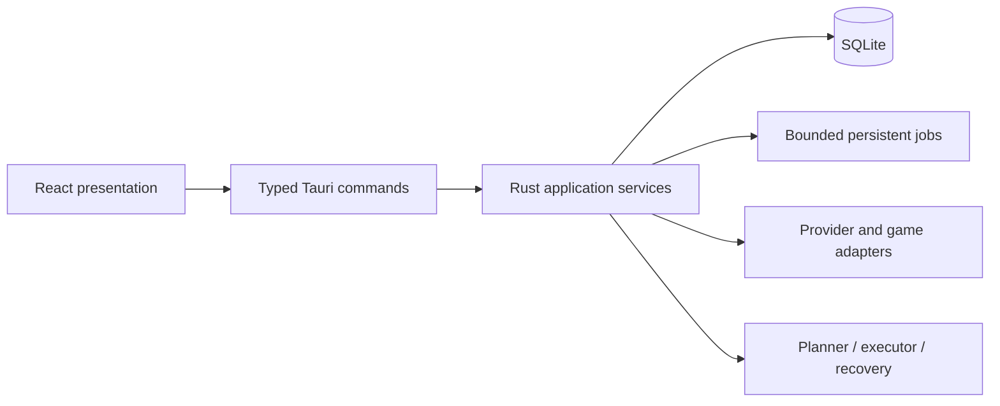
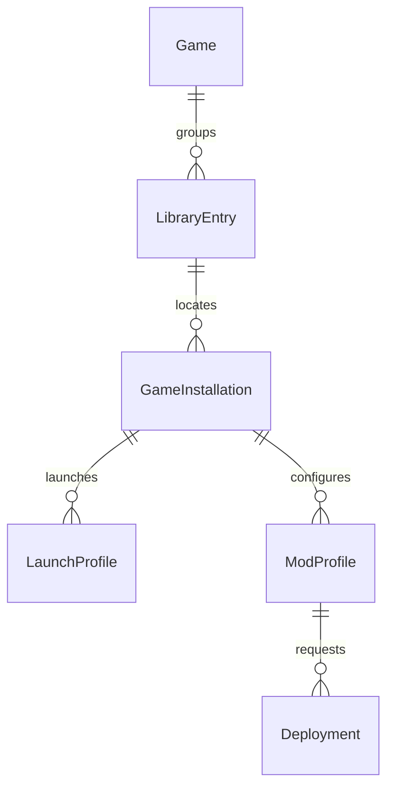

# Game Manager — Technical Architecture Specification

Revision: reconciled 2026-10-25 against the original [Game Manager Annotations Review](https://chatgpt.com/c/6add59c2-80bc-83ea-a64e-e890c3f606f6) and later user decisions. See [source and decision register](../SOURCE_AND_OPEN_DECISIONS.md).

**Implementation status: not started.** Specifications, interface sketches, SQL examples, and acceptance targets describe intended behavior; they are not existing code or verified results. Later explicit decisions override earlier drafts: installed Windows only, no portable distribution, no Playnite migration requirement, and external trainers first in later Game Tools work.

TAS v0.2 · Accepted architectural baseline; detailed implementation sketches remain subject to validation

October 25, 2026 · Based on PRD v0.1 and all accepted architecture decisions

## Executive summary

I recommend building Game Manager as a modular monolith: one Windows desktop application, one Rust backend, one local SQLite database, and clearly separated internal modules.

This approach offers the benefits of modular architecture without the complexity of running multiple background services or communicating across multiple processes.

The architecture must satisfy four primary objectives:

1. Performance: Remain responsive with 12,320+ games, including on systems where some data resides on an HDD.
2. Reliability: Protect game installations, mods, configuration files, and personal information from destructive operations.
3. Compatibility: Support multiple storefronts, standalone games, emulators, and different modding ecosystems.
4. Extensibility: Allow new game adapters, metadata providers, deployment strategies, and eventually third-party extensions without redesigning the core application.

### Technology decisions

| Layer | Selected technology |
| --- | --- |
| Windows desktop shell | Tauri 2 |
| Interface | React + TypeScript |
| UI styling | Tailwind CSS |
| Virtualized library | TanStack Virtual |
| UI state | Zustand |
| Async data cache | TanStack Query |
| Application/backend logic | Rust |
| Async runtime | Tokio |
| Database | SQLite + SQLx |
| Full-text search | SQLite FTS5 |
| Mod deployment | Hybrid, interchangeable backends |
| Background operations | Persistent Rust job scheduler |
| Mobile companion (later) | Flutter |
| Cloud synchronization (later) | Optional Supabase |

The architecture will use Tauri commands for request/response operations, and channels or events for long-running progress and notifications. This is consistent with Tauri 2's current communication model. 

## 1. High-level architecture

Frontend — React / TypeScript

Library · Game details · Mods · Launcher · Settings

Typed Tauri IPC

Rust Application Layer

Commands · Authorization · Use-case coordination

Library

Catalog and metadata

Launcher

Processes and sessions

Mods

Profiles and deployments

Integrations

Storefronts and emulators

Jobs

Queue and scheduling

Media

Images and thumbnails

Canonical local data

Filesystem

Games, mods, artwork, backups

External systems

Steam · GOG · Epic · Other launchers · Mod repositories · RomM · RetroAchievements

### Architecture rules

- React owns presentation, transient UI state, and user interactions.
- Rust owns business rules, database access, filesystem modification, process monitoring, and background operations.
- SQLite is the authoritative local source of structured application data.
- The frontend never issues raw SQL or arbitrary filesystem mutations.
- External services are accessed through provider adapters.
- Game-specific mod logic is isolated from general mod deployment.
- A failure in one integration must not prevent library browsing or launching unrelated games.
- Core functionality must continue without network access.

Importantly, we will not introduce microservices, a mandatory local HTTP server, or cloud infrastructure into the MVP.

## 2. Rust module boundaries

Each module should expose a small public interface. Modules may call other modules through explicit application services, but should not reach into each other's database repositories or internal state.

| Module | Owns | Does not own |
| --- | --- | --- |
| `catalog` | Game identities, library entries, grouping, metadata overrides | Executable processes or mod files |
| `discovery` | Storefront detection, import matching, installation discovery | Canonical game records |
| `launcher` | Launch configurations, game processes, session lifecycle | Mod deployment internals |
| `mod_core` | Mods, versions, profiles, dependencies, compatibility | File deployment implementation |
| `mod_deployment` | Deployment plans, manifests, backups, file operations, recovery | Mod repository metadata |
| `mod_adapters` | Game-specific mod paths, loaders, rules | Shared deployment infrastructure |
| `integrations` | External service APIs, authentication, rate limits | Direct library database writes |
| `media` | Artwork acquisition, decoding, thumbnails, media cache | Canonical game metadata |
| `jobs` | Scheduling, persistence, priorities, progress, cancellation | Business-specific job logic |
| `storage` | SQLite access, migrations, transaction management | UI business decisions |
| `settings` | Preferences, paths, and application configuration | Game metadata |
| `diagnostics` | Logging, performance metrics, health checks | Changing application data |

For now, the journal, dashboard, achievements, retro integrations, and mobile synchronization can remain separate planned modules. Their data needs should inform the schema, but their implementations should not expand the MVP unnecessarily.

### Dependency rules

I would use these dependencies:

- `commands` → `application services` → `domain modules` → `repositories`
- `application services` → `jobs` for long-running work
- `mod_core` → `mod_deployment` through an explicit interface
- `launcher` → `mod_core` for profile readiness, not direct mod installation
- `integrations` → normalized import results; `catalog` decides how these become library entries

Domain modules should not depend on Tauri. This lets us test their behavior with ordinary Rust unit and integration tests.

## 3. Repository and crate organization

The tree below is an eventual organization sketch. The later preparation decision is to start with a simple desktop structure and add meaningful Rust crates as boundaries emerge. It is not a requirement to scaffold this entire tree or create empty crates.

```text
game-manager/
├── apps/
│   ├── desktop/
│   │   ├── src/
│   │   │   ├── app/
│   │   │   ├── features/
│   │   │   │   ├── library/
│   │   │   │   ├── game-details/
│   │   │   │   ├── launcher/
│   │   │   │   ├── mods/
│   │   │   │   └── settings/
│   │   │   ├── components/
│   │   │   ├── hooks/
│   │   │   ├── ipc/
│   │   │   └── styles/
│   │   └── src-tauri/
│   │       ├── src/
│   │       │   ├── commands/
│   │       │   ├── bootstrap.rs
│   │       │   └── lib.rs
│   │       ├── capabilities/
│   │       └── tauri.conf.json
│   └── mobile/                 # Future
├── crates/
│   ├── gm-core/
│   ├── gm-storage/
│   ├── gm-library/
│   ├── gm-launcher/
│   ├── gm-modding/
│   ├── gm-integrations/
│   └── gm-jobs/
├── packages/
│   └── contracts/
├── benchmarks/
│   ├── fixtures/
│   └── scenarios/
├── docs/
│   ├── specifications/
│   └── decisions/
└── Cargo.toml
```

`gm-core` should contain small, reusable abstractions and identifiers, not become a dumping ground for unrelated logic.

We should also avoid building an extension-loader infrastructure prematurely. Internal adapters can use Rust traits and be compiled into the application. A stable plugin ABI is a separate future project.

## 4. Core data model and ownership

I recommend distinguishing four fundamental identities.

| Entity | Meaning | Example |
| --- | --- | --- |
| `Game` | Canonical title | Half-Life 2 |
| `LibraryEntry` | User's ownership or catalog entry | Half-Life 2 on Steam |
| `GameInstallation` | A particular installed copy | Steam installation on drive D: |
| `LaunchProfile` | A way to launch an installation | Vanilla, Source mod, custom flags |

This is important for your configurable grouping requirement.

A canonical game can have multiple library entries. A library entry can have multiple installations, and an installation can have multiple launch profiles.

Mod profiles belong to game installations or compatible installation contexts, not just titles. This prevents a mod configuration intended for one game version from being applied to another without validation.

### Key relationships

`Game → LibraryEntry → GameInstallation → LaunchProfile`; one-to-many at each step. ModProfile belongs to an installation or an explicitly validated compatible context. Deployment records bind a profile revision to actual verified installation state. This is the logical model, not the final SQLite DDL.

### Database design rules

1. Stable internal IDs should be generated independently of Steam, IGDB, or other external identifiers.
2. External IDs should be namespaced by provider.
3. Store dates and timestamps consistently in UTC, converting for display.
4. Preserve user-edited fields separately from provider metadata.
5. Store imported playtime independently from locally recorded sessions.
6. Avoid putting large binaries or artwork into SQLite.
7. Use foreign keys, explicit constraints, and versioned migrations.
8. Preserve a database schema version and independently version mod manifest formats.

### Suggested indexing strategy

| Table | Index purpose |
| --- | --- |
| `games` | Normalized title and canonical identity |
| `game_external_ids` | Unique provider + external ID |
| `library_entries` | Source, status, grouping, added date |
| `game_installations` | Library entry and installation state |
| `play_sessions` | Installation + session start |
| `mod_profile_entries` | Unique profile + mod identity |
| `mod_deployments` | Installation + active deployment state |
| `background_jobs` | Status + priority + creation time |
| FTS5 search table | Indexed title and selected searchable metadata |

We'll select composite indexes from measured query patterns and `EXPLAIN QUERY PLAN`, rather than adding an index for every possible field. SQLite's `PRAGMA optimize` will be part of database maintenance. 

## 5. Database concurrency and durability

SQLite remains an appropriate choice for this workload. The database size itself is unlikely to be the main limitation; excessive I/O, large result sets, artwork handling, and poorly scheduled work are more significant architectural risks.

I recommend:

- WAL mode for the local application database.
- A small, long-lived connection pool.
- Short read transactions and bounded write transactions.
- One coordinated logical writer for background batch operations.
- Busy timeouts and explicit handling of lock contention.
- No network filesystem hosting of the active SQLite database.
- Periodic checkpoint management and WAL-size monitoring.
- SQLite's backup facilities for consistent backups, rather than blindly copying the live database file.

WAL permits readers and a writer to operate concurrently, but SQLite still allows only one writer at a time. Its WAL implementation also has specific same-host filesystem requirements. 

Initial pool configuration to test: one write connection and a small number of read connections, starting around two to four readers. These are starting values, not final optimized settings.

SQLx provides asynchronous connection pooling and prepared-query reuse, which suits this design. 

## 6. Tauri IPC interface specification

A key requirement is that the frontend communicates through a typed, narrow API. We should not expose generic `execute_sql`, `write_file`, or `run_command` methods.

### Command inventory

| Group | Proposed commands |
| --- | --- |
| Application | `app_get_status`, `app_get_settings`, `app_update_settings` |
| Library | `library_query`, `library_get_game`, `library_create_game`, `library_update_game`, `library_remove_entry` |
| Installations | `installation_list`, `installation_update`, `installation_scan` |
| Launcher | `launch_profile_list`, `launch_profile_save`, `game_launch`, `game_stop_tracking` |
| Mod inventory | `mods_list`, `mods_inspect_archive`, `mods_import`, `mods_detect_existing` |
| Profiles | `mod_profiles_list`, `mod_profile_save`, `mod_profile_set_entries` |
| Deployment | `deployment_plan`, `deployment_apply`, `deployment_verify`, `deployment_recover` |
| Jobs | `jobs_list`, `jobs_get`, `jobs_cancel`, `jobs_retry` |
| Media | `media_get_asset`, `media_queue_thumbnail` |
| Backup | `backup_create`, `backup_validate`, `backup_restore` |
| Diagnostics | `diagnostics_get_summary`, `diagnostics_export` |

All command names are illustrative contracts to be finalized with the implementation.

### Example: library request and response

```typescript
type SortField =
  | "title"
  | "dateAdded"
  | "lastPlayed"
  | "playtime"
  | "releaseDate";

interface LibraryQuery {
  search?: string;
  sourceIds?: string[];
  platformIds?: string[];
  statuses?: string[];
  tags?: string[];
  installedOnly?: boolean;

  sort: {
    field: SortField;
    direction: "asc" | "desc";
  };

  groupInstallations: boolean;
  cursor?: string;
  limit: number;
}

interface GameSummary {
  id: string;
  title: string;
  coverAssetId?: string;
  platformNames: string[];
  installed: boolean;
  modded: boolean;
  localPlaytimeSeconds: number;
  lastPlayedAt?: string;
}

interface LibraryPage {
  items: GameSummary[];
  nextCursor?: string;
  totalCount?: number;
  revision: number;
}
```

`library_query` should return lightweight summaries only. Game descriptions, mod file manifests, achievement collections, and full artwork metadata belong in separate detail queries.

For Details View, the backend may eventually offer a dedicated projection including only the currently configured columns.

### Example: Rust command boundary

```rust
#[tauri::command]
pub async fn library_query(
    state: tauri::State<'_, AppState>,
    request: LibraryQuery,
) -> Result<LibraryPage, ApiError> {
    state
        .library_service
        .query(request)
        .await
        .map_err(ApiError::from)
}
```

The `AppState` object should hold shared service handles, not a giant collection of mutable application data.

Tauri's asynchronous commands allow this work to occur without requiring synchronous UI-thread execution. CPU-heavy work must still be scheduled appropriately rather than directly blocking the async runtime. 

### Error contract

All expected failures should return structured, recoverable errors.

```typescript
type ApiErrorCode =
  | "NOT_FOUND"
  | "VALIDATION_FAILED"
  | "PERMISSION_DENIED"
  | "RESOURCE_BUSY"
  | "CONFLICT"
  | "UNSUPPORTED"
  | "PROVIDER_UNAVAILABLE"
  | "OPERATION_CANCELLED"
  | "RECOVERY_REQUIRED"
  | "INTERNAL_ERROR";

interface ApiError {
  code: ApiErrorCode;
  message: string;
  details?: Record<string, unknown>;
  operationId?: string;
  retryable: boolean;
}
```

The frontend should display actionable error messages while Rust logs diagnostic context. Raw database or OS error details should not be exposed indiscriminately.

### Versioning and validation

- Every command validates inputs in Rust.
- Frontend and backend DTOs are generated or checked from a shared schema.
- Persistent job payloads carry a version.
- IPC contract changes are reviewed with application releases.
- IDs, paths, filters, and sorting options are validated before reaching repositories.
- The backend determines authorized and compatible operations; disabling a UI button is not sufficient enforcement.

## 7. Core data flows

### Flow A — Startup and first library render

1. Render the dark application shell and resolve installed storage roots.
2. Open the local database, run required migration/recovery assessment, and load essential settings.
3. Query a bounded first page of library summaries and mount visible rows plus overscan.
4. Load viewport thumbnails from the bounded cache; queue missing variants on workers.
5. Initialize optional provider checks and incremental discovery in the background.
6. Keep ordinary library use available while affected installations undergo mod recovery; block conflicting writes.

Important implementation detail: The shell can render before the database is ready, but normal library queries must wait for database readiness. Heavy scans, metadata refreshes, and external provider initialization should not be part of that critical path.

The startup coordinator will have explicit states:

`Starting → DatabaseReady → LibraryReady → BackgroundServicesReady`

Errors such as migration failure or an inaccessible data directory must produce a recovery screen, not an endless loading spinner.

### Flow B — Searching and sorting a 12,320-game library

Recommended frontend behavior:

- Search input debounce: initially around 100–150 ms, to be tuned.
- Immediate visual feedback when changing filters.
- Cancel or ignore superseded queries.
- Cache recent page results within a memory limit.
- Keep the previous results visible during brief transitions where appropriate.
- Never build a 12,320-row DOM table.
- Reset or explicitly retain cursor position when sort/filter changes.
- Use deterministic tie-breakers, such as stable game IDs.

For ordinary browsing, keyset pagination is preferable where practical. For arbitrary scrollbar jumps or very complex sorting, we may need an alternative query mechanism. The virtualizer's row positions must be reconciled with the database's pagination model.

For configurable grouping, the query layer should handle canonical-game grouping rather than returning duplicated records for React to merge.

### Flow C — Importing games

Imports must be idempotent. Reimporting an unchanged Steam library should not duplicate games, destroy manual edits, or require rescanning unrelated sources.

The import pipeline should have these stages:

1. Discover source records.
2. Normalize platform-specific fields.
3. Match existing canonical games and installations.
4. Stage ambiguous matches for review.
5. Commit validated batches.
6. Queue nonessential metadata and artwork acquisition separately.
7. Publish a library revision notification.

The import job should save checkpoints. After restarting the application, it should resume from a safe boundary or offer a clean restart, depending on the provider's capabilities.

### Flow D — Launching a modded game

This is one of our most important cross-module workflows.

The launcher must also support:

- Direct executable launch.
- Platform URI or registered protocol launch.
- Emulator + ROM + launch arguments.
- Game-specific loader invocation.
- Source-port launch profiles.
- Process attachment when the launcher starts a separate game process.

For Steam and other platforms, the process initially launched may not be the process that represents actual gameplay. Session tracking must account for handoff, child processes, and cases where the real game process cannot be reliably identified.

Playtime must be based on observed game activity, not simply on how long a launcher process remains open. Where tracking is uncertain, the application should report that uncertainty rather than silently recording misleading hours.

## 8. Hybrid mod-management architecture

The mod subsystem needs four independent abstractions.

| Abstraction | Main responsibility | Example |
| --- | --- | --- |
| `ModSourceProvider` | Obtain mod metadata and packages | Local archive, Nexus, Thunderstore |
| `GameModAdapter` | Understand game-specific modding rules | SMAPI, Source engine, Bethesda |
| `ActivationStrategy` | Determine how a selected mod becomes active | Files, launch arguments, mod-loader configuration |
| `DeploymentBackend` | Apply and reverse managed filesystem changes | Copy, links, future VFS |

An activation strategy is not necessarily a deployment backend. Doom II WAD selection, for example, may only require launch arguments. It should not be forced through a file-copy pipeline.

### Deployment interface

```rust
pub trait DeploymentBackend: Send + Sync {
    fn kind(&self) -> DeploymentKind;

    fn capabilities(
        &self,
        context: &DeploymentContext,
    ) -> DeploymentCapabilities;

    fn validate(
        &self,
        plan: &DeploymentPlan,
    ) -> Result<ValidationReport, ModError>;

    fn prepare(
        &self,
        plan: &DeploymentPlan,
    ) -> Result<PreparedDeployment, ModError>;

    fn apply(
        &self,
        prepared: &PreparedDeployment,
        journal: &mut DeploymentJournal,
    ) -> Result<DeploymentResult, ModError>;

    fn recover(
        &self,
        operation_id: OperationId,
    ) -> Result<RecoveryReport, ModError>;
}
```

This example is deliberately synchronous. File-intensive work would run through controlled blocking workers or equivalent task executors. We should not perform blocking filesystem operations on Tokio's core async worker threads.

The production design will need richer recovery state and explicit cancellation checkpoints.

### Game adapter interface

```rust
pub trait GameModAdapter: Send + Sync {
    fn id(&self) -> AdapterId;

    fn detect(
        &self,
        installation: &GameInstallation,
    ) -> Result<DetectionReport, ModError>;

    fn capabilities(
        &self,
        installation: &GameInstallation,
    ) -> ModCapabilities;

    fn inspect_package(
        &self,
        package: &ModPackage,
    ) -> Result<PackageInspection, ModError>;

    fn build_activation_plan(
        &self,
        profile: &ModProfile,
        installation: &GameInstallation,
    ) -> Result<ActivationPlan, ModError>;
}
```

Every adapter must declare its actual capabilities. We must not assume a game supports profile switching, safe removal, load ordering, or dependency checks simply because its mods have a recognizable directory structure.

### Initial adapter strategy

Based on your game list, I would use the following progression.

| Game or ecosystem | Planned initial role | Implementation stage |
| --- | --- | --- |
| Half-Life 2 | Source mod discovery and launch profiles | Early |
| Classic Doom II | WAD/PK3 selection and source-port arguments | Early |
| Stardew Valley | SMAPI-aware mod identification and folder deployment | Early |
| Terraria | External tModLoader coordination | Later |
| Minecraft | Instance and mod-loader integration | Later |
| Cyberpunk 2077 | Multi-framework mod support | Later |
| Skyrim | Complex plugin/load-order and conflict rules | Later |
| Baldur's Gate 3 | Native and third-party mod workflow compatibility | Later |

These are engineering priorities, not claims that every listed workflow is already supported.

### Mod import and existing-file adoption

You explicitly want Game Manager to detect existing mods and ask before managing them. I recommend three ownership states:

| State | Meaning | Permitted operations |
| --- | --- | --- |
| `Observed` | Mod or file detected, externally owned | Inspect, catalog, warn |
| `AdoptionPending` | User has requested management | Analyze, preview, back up |
| `Managed` | Ownership and recovery baseline established | Deploy, disable, replace, restore |

An observed mod must never be silently deleted or overwritten.

Adoption should include:

1. Detect installed files and candidate mod identities.
2. Identify possible external manager ownership.
3. Present a proposed adoption plan.
4. Back up or safely preserve existing state.
5. Validate that the mod's installation can be represented by our manifest.
6. Require explicit user confirmation.
7. Mark only verified files as managed.

If the application cannot establish a safe rollback state, the adoption operation should fail or remain catalog-only.

### Deployment plan and manifest

```typescript
interface DeploymentPlan {
  id: string;
  installationId: string;
  profileId: string;
  backend: "copy" | "symlink" | "hardlink" | "vfs";

  expectedInstallationRevision: number;

  operations: DeploymentOperation[];
  conflicts: DeploymentConflict[];
  warnings: string[];

  estimatedAdditionalBytes: number;
  requiresGameClosed: boolean;
  canRecover: boolean;
}

type DeploymentOperation =
  | {
      kind: "copy";
      sourceAssetId: string;
      destination: string;
    }
  | {
      kind: "link";
      sourceAssetId: string;
      destination: string;
      linkType: "symbolic" | "hard";
    }
  | {
      kind: "restore_original";
      destination: string;
      backupId: string;
    }
  | {
      kind: "remove_managed";
      destination: string;
      expectedHash: string;
    };
```

The public plan can describe intended changes. The backend must still independently validate the plan immediately before application.

The complete persisted manifest should additionally record file hashes, original ownership, backup references, chosen mod versions, deployment sequence, actual filesystem changes, and operation status.

### Deployment state machine

MDRS supplies the detailed lifecycle. A plan progresses through Draft, Validated, Preparing, Prepared, Applying and Verifying; Active requires successful verification. Interrupted or failed mutations go through Recovering to Restored or Recovery Required. Failed Before Mutation applies only when no game-file mutation occurred. Journal state and observed disk evidence must be reconciled after a crash.

At most one active deployment may own a particular installation. The deployment scheduler must acquire an installation-specific lock before preparing changes.

A plan must be rejected if the installation changed after validation and the changes could invalidate the operation.

### Filesystem safety rules

- Resolve and validate destinations against approved installation roots.
- Reject path traversal and unexpected absolute paths in archives.
- Treat symlinks, junctions, and other Windows reparse points as security-relevant.
- Preserve originals before replacement when recovery depends on them.
- Verify managed-file ownership and hashes before removing files.
- Never overwrite files changed externally without revalidation.
- Restrict archive extraction sizes and expansion ratios.
- Never execute bundled mod installers automatically.
- Disallow deployment while the affected game or relevant tools are actively using the installation.
- Report interrupted operations and reconcile them before further deployment.
- Do not claim global filesystem atomicity: use durable journaling and best-effort compensation/recovery.

This is a higher priority than supporting dozens of adapters quickly. Reliable modification of game installations is a key reason for designing the mod subsystem carefully.

## 9. Persistent background-job scheduler

The scheduler is a core application service, not a convenience feature.

Its purpose is to guarantee that metadata imports, thumbnail generation, filesystem scans, and mod operations do not compete uncontrollably with interactive requests.

### Job model

```typescript
type JobKind =
  | "library_import"
  | "installation_scan"
  | "metadata_refresh"
  | "thumbnail_generation"
  | "mod_archive_inspection"
  | "mod_deployment"
  | "mod_recovery"
  | "database_backup";

type JobState =
  | "queued"
  | "running"
  | "pause_requested"
  | "cancel_requested"
  | "completed"
  | "failed"
  | "recovery_required";

interface JobRecord {
  id: string;
  kind: JobKind;
  state: JobState;
  priority: number;

  createdAt: string;
  startedAt?: string;
  completedAt?: string;

  progressCurrent?: number;
  progressTotal?: number;

  attempts: number;
  errorCode?: string;
}
```

### Job scheduling policies

| Class | Examples | Scheduling policy |
| --- | --- | --- |
| Interactive | Search, game details | Direct prioritized requests; not queued behind imports |
| Foreground operations | User-triggered mod deployment | Dedicated job with installation lock |
| Normal | Manual library import | Bounded background workers |
| Low priority | Metadata refresh, thumbnail generation | Throttled and pausable |
| Maintenance | Database optimization, orphan cleanup | Idle-time scheduling |

I would initially configure independent concurrency budgets:

- Database write-intensive jobs: one coordinated batch writer.
- Metadata network fetches: per-provider limits.
- CPU-intensive artwork processing: one or two workers initially.
- Filesystem scans: limited concurrency, especially on HDDs.
- Mod deployment: one operation per installation, with global I/O limits.

These numbers should be tunable based on benchmark results and detected storage characteristics.

### Persistence and recovery

A critical distinction is that not all interrupted jobs should resume automatically.

Metadata imports may resume from validated checkpoints. Mod deployments must first reconcile the filesystem with their journal. Automatic retries must not repeat potentially destructive actions blindly.

Every persistent job needs an idempotency policy, versioned payload, retry policy, and recovery procedure.

### Progress communication

I recommend using:

- Tauri commands to create, inspect, cancel, and retry jobs.
- Tauri events for small state-change notifications.
- Tauri channels for ordered, more frequent progress updates.
- SQLite as the authoritative source of persisted job state.

Tauri distinguishes its general-purpose event system from channels optimized for streaming workloads. 

Example notifications:

```text
job.started
job.progress
job.completed
job.failed
job.recovery_required

library.changed
installation.changed
mod_profile.changed
game.session_changed
```

Events should carry identifiers and compact summaries, not thousands of records.

The frontend should be able to request a fresh job snapshot after reconnecting or reopening the application. Notifications are not the source of truth.

## 10. Artwork and media subsystem

Your preference for a visually rich interface creates an important architectural requirement: artwork must be managed as a separate resource pipeline.

The media subsystem should never force the library query layer to retrieve or decode full-resolution images.

### Media storage

```text
AppData/
├── database/
│   └── game-manager.db
├── media/
│   ├── originals/
│   ├── thumbnails/
│   │   ├── covers-small/
│   │   ├── covers-medium/
│   │   └── backgrounds/
│   └── temporary/
├── mods/
├── backups/
├── jobs/
├── logs/
└── settings.json
```

This is a logical layout. The actual Windows data directories will follow the installed-only storage policy in DSS.

I recommend content-addressed storage for imported artwork and mod archives where practical. It reduces duplicate files and gives us a way to validate cached content.

### Thumbnail pipeline

Recommended behavior:

- Generate thumbnail variants asynchronously.
- Store cache keys based on source identity and transformation version.
- Prioritize currently visible artwork.
- Lazy-load offscreen content.
- Apply bounded memory caching.
- Invalidate thumbnails only when the source or transformation changes.
- Avoid unnecessary redecoding while scrolling.

Tauri's asset protocol can expose selected local files to the WebView, but its filesystem scope must be configured carefully. We should expose only approved cache directories rather than allowing unrestricted access to local game installations. 

Artwork cache generation must also protect against malformed images and decompression bombs, with image dimensions and processing limits.

### HDD/SSD strategy

Given your current setup, we should support configurable storage roots:

| Data | Preferred location |
| --- | --- |
| SQLite database | SSD |
| Frequently displayed thumbnails | SSD |
| Original artwork | SSD or HDD |
| Mod archives | User-selected drive |
| Temporary deployment staging | Compatible local drive with sufficient space |
| Games and ROMs | Existing drives, no relocation required |
| Deployment backups | Configurable location, with compatibility and space checks |

We should avoid creating an architecture where relocating the application forces games or mod archives to move with it.

## 11. Frontend architecture

Since you primarily use Details View, that view should drive the first frontend prototype.

### Feature organization

| Frontend feature | Components | Backend dependency |
| --- | --- | --- |
| Library | Virtualized table, grid, filter bar, grouping | `library_query` |
| Game details | Header, metadata, installations, launch actions | `library_get_game` |
| Mods | Inventory, profile selector, conflict view, deployment preview | Mod commands |
| Launcher | Profile picker, run state, process status | Launcher commands |
| Jobs | Progress, errors, cancellation, recovery | Job commands |
| Settings | Storage paths, performance, integration preferences | Settings commands |

### State management rules

Zustand: Navigation state, UI layout preferences, selection state, temporary dialogs, and other small client-only values.

TanStack Query: Backend data snapshots, caching, invalidation, loading state, and stale-query handling.

SQLite: Persisted games, metadata, profiles, and application records.

We must avoid storing a complete 12,320-game catalog in Zustand simply because it is convenient. That duplicates state and creates unnecessary frontend work.

### Details View implementation

The initial view should support:

- Virtualized rows.
- Resizable columns.
- Column visibility settings, even if initial customization is limited.
- Sortable columns.
- Keyboard navigation.
- Multi-selection.
- Fast detail-panel opening.
- Configurable grouping of multiple installations.
- A stable scroll position when returning from details.
- Efficient updates when an import changes a small subset of records.

For the virtualizer, use an estimated row height and measured heights only where necessary. Fixed or predictable row heights will generally simplify implementation and reduce work.

TanStack Virtual provides the required React virtualizer primitives. 

TanStack Virtual React Docs

### Responsiveness requirements

- Searching does not block typing.
- Sorting does not reconstruct the complete DOM.
- Background jobs do not push continuous expensive rerenders.
- Opening a game loads detail sections independently.
- Offscreen game cards do not retain large decoded images unnecessarily.
- Mod inventory panels are virtualized independently from the game library.

### Theme system

We'll start with one polished dark theme.

However, I recommend defining CSS design tokens from the beginning for typography, spacing, surfaces, borders, accents, focus states, and motion.

That makes a later light theme and your website-inspired custom theme easier to implement without requiring a new component architecture.

We should not implement a full third-party theming engine in the MVP.

## 12. Security and trust boundaries

Game Manager will have access to game executables, private directories, archives, and external metadata. Its security architecture deserves special attention.

### Trust model

| Input | Trust level | Validation required |
| --- | --- | --- |
| Bundled application code | Trusted release artifact | Supply-chain and release integrity |
| User-selected local files | Not automatically safe | Paths, type, size, permissions |
| Mod archives | Untrusted | Extraction safety, file limits, content inspection |
| External metadata | Untrusted | Schema validation, escaping, size limits |
| Third-party game adapters | Trusted only when bundled and reviewed | Capability restrictions, testing |
| Future third-party extensions | Untrusted by default | Sandboxing and permission model |

Tauri 2 supports capability-based permissions and scopes, but that protection does not replace validation within Rust commands. The Rust backend must enforce operation-specific authorization and path restrictions. 

### Security requirements

1. No arbitrary shell-command IPC endpoint.
2. No unrestricted filesystem access from React.
3. No automatic execution of mod archive contents.
4. No hidden privilege escalation to install mods.
5. Explicit confirmation for destructive operations.
6. Content Security Policy appropriate for a local desktop application.
7. Provider credentials stored through appropriate OS-protected mechanisms where available.
8. No analytics or telemetry by default without a deliberate privacy decision.
9. No mandatory accounts for core functionality.
10. Network requests and authentication confined to the relevant integration modules.

The future extension marketplace is especially significant. Loading arbitrary native plugins directly into the application process would weaken isolation. We should revisit the extension architecture separately, potentially using constrained processes or sandboxed runtimes rather than unrestricted native code.

## 13. Performance specification

This is the section I would treat as the most important acceptance contract for the project.

### 13.1 Benchmark environments

### Primary reference configuration

CPU

AMD Ryzen 5 4500

Memory

64 GB RAM

Library

12,320 actual-game-equivalent records

Primary view

Details View

Storage scenarios

SSD and HDD

Stress test

25,000 games

We should also have a secondary test configuration with 8–16 GB RAM and a mainstream lower-end CPU.

Your 64 GB system should not become the application's implicit minimum requirement.

### 13.2 Performance budgets

These are proposed engineering targets, not measured results.

| Metric | Target | Measurement |
| --- | --- | --- |
| Warm application startup | Initial library interactive within 1 second after window creation | Median |
| Cold startup | Record and optimize separately; target under 3 seconds on reference SSD | Median |
| Typical indexed search | Under 100 ms | p95 |
| Indexed filter/sort | Under 150 ms | p95 |
| Library row retrieval | Under 50 ms for a small indexed page | p95 |
| Cached game details | Under 150 ms | p95 |
| Details View scrolling | Target 60 FPS | Frame-time distribution |
| Long frames during scrolling | Minimize frames over 50 ms; investigate recurring spikes | Count and p99 |
| Import responsiveness | User input remains responsive during active imports | Interaction latency |
| Background idle overhead | No continuous scanning or polling without purpose | CPU and disk activity |
| Memory | Stabilizes during sustained navigation | Working-set and heap trends |

These targets require a clearly defined test environment. For example, the warm startup result assumes the local database is accessible and no migration is running.

For scrolling, a 60 FPS target corresponds to an approximate 16.7 ms frame budget. We should measure dropped frames and long tasks rather than relying on a subjective impression of smoothness.

### 13.3 Hard architectural limits

I recommend establishing these initial constraints:

| Resource | Initial budget or rule |
| --- | --- |
| Library page size | Typically 50–100 summaries |
| Mounted library rows | Visible viewport + bounded overscan |
| Normal query results | Summaries only; no full descriptions or mod manifests |
| Search input | Debounced and stale-request-safe |
| Thumbnail decode | Never decode full-resolution covers for small rows |
| Artwork memory cache | Explicitly bounded and configurable |
| Database writes | Short, batched transactions |
| Import progress | Throttled notifications; no per-file UI updates |
| Startup discovery | No full-library or all-mod scan |
| Concurrent disk-heavy jobs | Strictly limited, especially on HDD |

We should tune numerical values using measurements rather than considering them universally optimal.

### 13.4 Required benchmark scenarios

01

Cold startup

Application closed; cold filesystem cache where reproducible

02

Warm startup

Reopen application with caches populated

03

Details View scrolling

Navigate from first to last entries, including rapid scrolling

04

Search and filtering

Search common and rare titles, combine filters and sorts

05

Import under load

Browse and search while importing thousands of records

06

Thumbnail generation

Scroll while missing thumbnails are generated

07

Mod processing

Browse the library during archive inspection or hashing

08

Deployment recovery

Interrupt a controlled test deployment and restore consistency

09

Long session

Browse, search, open details, and return repeatedly

10

HDD stress

Run application data and disk-heavy jobs on a slower drive

### 13.5 Benchmark instrumentation

I recommend instrumenting the application with:

- Rust `tracing` spans for commands, jobs, and provider operations.
- SQLite query execution measurements and slow-query diagnostics.
- React Profiler during development.
- Browser/WebView performance traces.
- Memory working-set measurements.
- Cache hit/miss and thumbnail decode metrics.
- Filesystem throughput and job queue depth.
- Startup-stage timestamps.

Each benchmark should record the application version, hardware, storage placement, cache state, dataset version, and concurrent workload.

We should store measurements over time and compare them against a baseline so performance regressions can be detected before release.

No performance-sensitive feature should be considered complete without testing against the 15,000-game dataset.

## 14. Testing and quality assurance

The testing strategy should follow the architectural boundaries.

| Test level | Primary focus |
| --- | --- |
| Rust unit tests | Domain rules, identity matching, profile resolution |
| Repository integration tests | Database queries, indexes, constraints, migrations |
| IPC contract tests | Serialization, validation, errors, command behavior |
| Adapter tests | Game detection, mod inspection, supported capabilities |
| Filesystem tests | Deployment, backup, rollback, external modification |
| Fault-injection tests | Interrupted writes, disk exhaustion, locked files |
| Frontend unit tests | Filters, selection, reducers, presentation |
| End-to-end tests | Library browsing, importing, launching, mod profiles |
| Benchmark tests | Latency, memory, scrolling, background I/O |
| Security tests | Archive traversal, unauthorized paths, unsafe links |

### Critical mod-manager tests

Before shipping managed deployment, tests must verify:

- An original game file can be restored after a managed replacement.
- An externally modified file is not silently deleted.
- An interrupted operation is detected after restart.
- An unsuccessful recovery enters a clear `recovery_required` state.
- Two deployment jobs cannot modify the same installation concurrently.
- A profile cannot deploy to the wrong game version without validation.
- Malicious archive paths cannot escape the configured extraction root.
- Mod adoption does not silently change ownership of files.

These tests should operate on disposable test installations, not the user's real game directories.

## 15. Installed Windows distribution and upgrades

Only an installed Windows application is in scope. Portable mode was explicitly dropped after the original TAS and DSS drafts. Do not implement portable builds, detection, data-directory overrides for portable mode, relocation support, or portable-specific testing.

Retain centralized path resolution, separation of binaries from durable user data, configurable data roots, mixed SSD/HDD placement, and installation verification before mutation. Configurable initial storage locations are distinct from moving an active managed store; live storage relocation is outside the first release.

Use a single installer format initially. NSIS was suggested; final installer format, signing, updater, minimum Windows versions, and architectures still require selection and validation. Uninstall must distinguish binaries, user data, cache, packages, backups, and external game installations.

### Data migration policy

- Forward-only, version-controlled migrations and explicit schema/manifest versions.
- Consistent backups before potentially destructive upgrades.
- Clear failure and recovery paths; never silently replace a failed database.
- Downgrade compatibility must be explicit; restoring database state requires filesystem reconciliation.

## 16. Development milestones and acceptance gates

I would organize implementation around working vertical slices rather than implementing every backend module before creating a UI.

Milestone 0 — Performance prototype

Tauri + Rust + SQLite + virtualized React Details View, 15,000 synthetic game records, and realistic thumbnails.

Gate: Measure startup, scrolling, search, memory, and concurrent I/O before committing to the full architecture.

Milestone 1 — Library foundation

Canonical game model, grouped installations, library queries, SQLite migrations, manual entry, and basic Steam import.

Gate: Repeatable imports, no duplicate identities, responsive browsing at release-scale dataset size.

Milestone 2 — Launcher and background processing

Launch profiles, process tracking, local play sessions, job scheduler, progress UI, and cancellation.

Gate: Imports do not block interaction; supported games launch and tracking failures are handled correctly.

Milestone 3 — Universal mod foundation

Mod inventory, archives, profiles, managed storage, deployment planner, copy backend, and recovery journal.

Gate: Deployment and reversal pass filesystem safety tests, including simulated interruptions.

Milestone 4 — Initial game adapters

First validated Source-engine, SMAPI, or Doom source-port workflows, depending on prototype feasibility.

Gate: End-to-end mod import, activation, launch, deactivation, and recovery on supported test games.

Milestone 5 — MVP stabilization and release

Finalized dark theme, packaging, settings, backup/restore, error handling, documentation, and compatibility testing.

Gate: All critical performance and data-safety acceptance tests pass.

The initial launch should not wait for GOG, Epic, Ubisoft, EA, Amazon, and all eight modding ecosystems to be fully integrated. Those are subsequent integration milestones.

## 17. Architecture decisions and open issues

### Accepted decisions

The five repository ADR filenames are the stable package identifiers. The eight labels used in the original chat TAS were preliminary labels; their mapping is recorded in the source register.

| Decision | Repository authority |
| --- | --- |
| Hybrid mod engine; managed copy first; launch-time activation; links later; VFS long-term | [ADR-001](../decisions/ADR-001-hybrid-mod-deployment.md) |
| Installed Windows only; portable mode removed | [ADR-002](../decisions/ADR-002-installed-only-windows.md) |
| Core stack, SQLite source of truth, offline core and module ownership | [ADR-003](../decisions/ADR-003-core-stack-and-local-first.md) |
| Virtualized Details View and scale benchmarks | [ADR-004](../decisions/ADR-004-virtualized-details-and-benchmark.md) |
| Future trainers progressively, external first | [ADR-005](../decisions/ADR-005-external-first-trainers.md) |
| Configurable installation grouping; Library + Mod Manager MVP; built-in functionality first | [PRD](PRD.md) and [decision register](../SOURCE_AND_OPEN_DECISIONS.md) |

### Proposed decisions to validate through implementation

| Decision | Proposed approach |
| --- | --- |
| SQLite access | SQLx with coordinated writes and small read pool |
| Background jobs | Persistent queue and bounded Rust workers |
| Media storage | Filesystem-backed, variant-based thumbnail cache |
| Search | FTS5 plus indexed structured filters |
| IPC contracts | Typed DTOs with generated or checked TypeScript counterparts |
| Mod manifest | Versioned, journaled, hash-aware ownership records |
| Mod adoption implementation | Consent is agreed; concrete preview/preservation/manifest mechanics need validation |
| First mod adapters | Half-Life 2, Stardew Valley, classic Doom II as candidate targets |
| Backend structure | Modular Rust workspace, no microservices |

These proposed choices are strong implementation starting points but should remain adjustable if prototypes reveal problems.

## 18. What I would implement first

The first engineering deliverable is M0, the performance-validation prototype. Its implementation has not started.

It should contain just enough functionality to demonstrate that our technology choices solve your primary complaint about Playnite.

### Performance prototype — definition of done

All eight work items are pending:

- [ ] Tauri desktop window with one dark theme.
- [ ] SQLite database with 15,000 realistic synthetic game records.
- [ ] Virtualized Details View with sortable columns.
- [ ] Search and filter commands implemented in Rust.
- [ ] Realistic cover-thumbnail loading and caching.
- [ ] Background import simulator with progress reporting.
- [ ] Benchmark startup, scrolling, search, and memory.
- [ ] Run measurements with SSD and HDD storage.

These are requirements for future M0 work. Accidental historical checkmarks were explicitly withdrawn.

## Final architecture recommendation

Game Manager should be a performance-first, modular Windows desktop application with Rust controlling all persistent, privileged, and computationally expensive operations.

The most important architectural commitments are:

- A virtualized, database-driven library designed around Details View.
- No full-library loading or scanning during normal startup.
- A persistent, priority-aware background-job system.
- Clear boundaries between library identities, installations, launch configurations, and mod profiles.
- A hybrid mod engine that supports both filesystem-based and launch-time mod activation.
- Strict file ownership, deployment journaling, and recovery guarantees.
- Optional integrations that never become dependencies of core offline functionality.

This specification provides the foundation for implementation, though its performance targets and lower-level design choices still need validation.

The [DSS](DSS.md) and [MDRS](MDRS.md) now contain the recovered subsequent detailed designs. Their schema, storage, state-machine and interface proposals must be validated through focused engineering. The next implementation milestone remains M0.

## 19. Reconciliation details and retained boundaries

The exact [integration order and eight mod targets](PRD.md) are confirmed. Initial adapters remain candidate workflows until tested. Game-specific adapters describe activation and compatibility; deployment backends execute validated filesystem plans. Launch-time activation is a separate strategy and can avoid game-file writes entirely.

The original crate tree is a proposed eventual organization, not existing files. The later repository-preparation decision was to begin with `apps/desktop/`, `docs/specifications/`, `docs/decisions/`, and benchmark fixtures, adding Rust crates only as meaningful boundaries emerge. Do not create empty crates or an extension loader simply to mirror the sketch. Use pnpm; dependency versions and actual check/build commands will be established during separately authorized scaffolding.

Frontend DTOs, Rust traits, commands and state enums in this document are design sketches. Persisted schema and deployed-state vocabulary must be reconciled with DSS/MDRS before implementation. Public commands validate identifiers, enum values, query limits, revisions, paths and permissions in Rust; frontend validation is insufficient. Never expose arbitrary SQL, shell or filesystem execution.

The original diagrams are represented by these relationships:





MDRS defines the more detailed deployment lifecycle: Draft → Validated → Preparing → Prepared → Applying → Verifying → Active, with Recovering, Restored, Recovery Required and Failed Before Mutation outcomes. Earlier simplified state diagrams are conceptual summaries, not an alternative persisted protocol.

Optional Flutter and Supabase entries describe future candidate technologies only; no mobile or cloud work is part of this documentation task or M0. No provider outage may block core offline use. Tests that mutate files use disposable installations only. No performance or recovery results exist yet.
